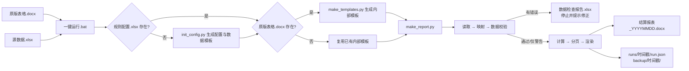

# Automated-Settlement-Report-Engine

> 把 Word 表格和 Excel 数据放进同一个文件夹，双击一次，生成结算报表。

一个面向**个人和小团队**的本地结算报表生成器。它把「原版 Word 表格」自动转换成带循环标签的模板，再读取 Excel 数据、按规则计算、分页并渲染成最终 Word 报表。全程不需要打开 Word 手工复制粘贴，也不依赖服务器或数据库。

> **一句话定位**：把「固定格式的 Word 表格」和「已经整理好的 Excel 数据」稳定地合成一份可归档的结算报表。
>
> 它不负责数据采集、审批流、多人协作，也不替代财务复核。

- **输入**：`原版表格.docx` + `源数据.xlsx`
- **输出**：`结算报表_YYYYMMDD.docx`
- **操作**：双击 `一键运行.bat`
- **特点**：配置与代码解耦、模板自动生成、计算规则可配置、固定行数/自动分页、模板诊断、数据校验报告、生成前预览、上期差异对比、运行清单与备份、文件占用友好提示

---

## 目录

- [定位与使用范围](#定位与使用范围)
- [1. 30 秒快速开始](#1-30-秒快速开始)
- [2. 工作流](#2-工作流)
- [3. 目录结构](#3-目录结构)
- [4. 输入文件详解](#4-输入文件详解)
  - [4.1 原版表格.docx](#41-原版表格docx)
  - [4.2 源数据.xlsx](#42-源数据xlsx)
  - [4.3 规则配置.xlsx](#43-规则配置xlsx)
- [5. 计算规则](#5-计算规则)
- [6. 模板与占位符](#6-模板与占位符)
- [7. 分页规则](#7-分页规则)
- [8. 命令行用法](#8-命令行用法)
  - [8.1 初始化](#81-初始化)
  - [8.2 生成模板](#82-生成模板)
  - [8.3 生成报表](#83-生成报表)
  - [8.4 退出码](#84-退出码)
  - [8.5 在其他目录运行](#85-在其他目录运行)
  - [8.6 预览：生成前先看数据](#86-预览生成前先看数据)
  - [8.7 差异对比：和上一期比](#87-差异对比和上一期比)
  - [8.8 运行产物：数据检查报告、run.json、备份](#88-运行产物数据检查报告runjson备份)
  - [8.9 模板诊断](#89-模板诊断)
  - [8.10 便携版 exe](#810-便携版-exe)
- [9. 常见问题](#9-常见问题)
- [10. 设计说明](#10-设计说明)
- [11. 开发与测试](#11-开发与测试)
- [12. 许可证](#12-许可证)

---

## 定位与使用范围

### 它是什么

Automated-Settlement-Report-Engine 是一个**本地、文件驱动、模板优先**的报表生成器：

| 特征 | 说明 |
| --- | --- |
| 本地 | 在 Windows 上用 Python 或便携 exe 运行，不需要服务器、数据库、账号体系 |
| 文件驱动 | 输入是 `原版表格.docx`、`源数据.xlsx`、`规则配置.xlsx`；输出是 Word/Excel 文件 |
| 模板优先 | 以现有 Word 表格为版式基准，而不是让用户重新设计报表 |
| 可追溯 | 每次运行留下数据检查报告、`run.json`、输出哈希和覆盖前备份 |
| 可配置 | 计费项、单价、字段映射在 Excel 里维护，常规调整不需要改代码 |

它解决的是“**已经结构化的数据 → 公司格式 Word 报表**”的最后一公里，不解决数据从哪里来、数据是否真实、审批是否合规。

### 最适合的场景

- 个人或小团队，每月/每周重复出同类报表；
- Word 模板基本固定，主表是规则的行列表格；
- Excel 数据已经整理好，列名稳定或可通过映射表对应；
- 计算规则可以用“单价 × 数量或次数 + 固定金额”表达；
- 需要在 Windows 上离线运行，结果要尽量贴近原模板；
- 希望保留检查报告、运行记录和覆盖前备份。

### 也能用，但要先验证

- **多个不同模板**：建议一个模板一个目录，分别放配置和数据；
- **历史数据批量补做**：可以循环调用 CLI，但需要自己管理输入输出目录；
- **表格有合并表头**：只支持规则的多行表头，不支持任意复杂合并；
- **数据里有负数、空值、单位后缀**：引擎会尽量解析，但仍建议先看 `数据检查报告.xlsx`。

### 不适合的场景

- **数据采集、填报、审批、权限管理**：没有表单、流程、角色、多人协作；
- **OCR、PDF、图片取数**：输入必须是结构化的 `.xlsx`；
- **复杂 Word 排版**：不支持浮动表格、嵌套子报表、任意单元格合并、图文混排；
- **多表主从、一对多明细**：一个模板只处理一个主表；
- **税务、社保、工资合规计算**：只做配置化加减乘除，不提供合规判断；
- **高并发、在线服务**：没有 Web 服务、任务队列、数据库；
- **替代财务复核**：生成结果必须由业务人员核对后再对外使用。

### 使用前提

1. Windows 10/11，安装 Microsoft Office 或 WPS，用于打开和检查生成的 `.docx`；
2. Python 3.10+，或使用打包后的便携 exe；
3. `原版表格.docx` 中有一个明确的主表：表头行 + 数据行 + 可选的合计行；
4. `源数据.xlsx` 一行一条记录，列名能通过 `规则配置.xlsx` 的字段映射对应到标准字段；
5. 愿意在首次使用时检查模板诊断和 `数据检查报告.xlsx`，而不是直接信任输出。

> 模板诊断会拒绝浮动表格、纵向合并数据行、嵌套表格等不符合条件的结构。这不是“识别失败”，而是有意阻止生成不可靠的报表。

### 数据与公开仓库边界

- 工具本身在本地处理文件，不会上传数据；
- 但 `源数据.xlsx`、生成的报表、截图、日志、`run.json` 可能包含真实姓名、工号、工资等信息；
- **不要把这些文件提交到公开仓库**；本项目的 `.gitignore` 已忽略常见生成物，但仍需自己检查；
- 仓库中的示例和测试数据均为合成数据，不对应任何真实个人。

更完整的风险、路线图和开源前检查清单见 [10.5 适用边界与开源前评审](#105-适用边界与开源前评审)。

---

## 1. 30 秒快速开始

### 1.1 准备 Python

需要 **Python 3.10 或更高版本**，Windows 安装时请勾选 `Add Python to PATH`。

```powershell
python --version
```

如果提示找不到 `python`，也可以安装后使用 `py -3`；`一键运行.bat` 会自动尝试这两种启动方式。

### 1.2 安装依赖

在项目目录打开终端：

```powershell
python -m pip install -r requirements.txt
```

依赖只有三个：

| 依赖 | 用途 |
| --- | --- |
| `openpyxl` | 读写 `规则配置.xlsx`、`源数据.xlsx` |
| `python-docx` | 读取原始 Word 表格、生成模板、分页 |
| `docxtpl` | 用 Jinja2 标签渲染 Word 模板 |

> `一键运行.bat` 会先检查依赖；缺失时会尝试自动执行 `pip install -r requirements.txt`。如果公司网络无法访问 PyPI，可先手动换源安装。

### 1.3 放入两个文件

把下面两个文件放到**项目根目录**（和 `一键运行.bat` 同一层）：

```text
Automated-Settlement-Report-Engine/
├─ 原版表格.docx      ← 你的原始 Word 表格
├─ 源数据.xlsx        ← 填好的 Excel 数据
├─ 一键运行.bat
└─ ...
```

### 1.4 双击运行

双击 `一键运行.bat`。程序会：

1. 检查依赖；
2. 没有 `规则配置.xlsx` 时自动生成配置和 `源数据模板.xlsx`；
3. 有 `原版表格.docx` 时自动生成 `_内部模板.docx`；
4. 校验 `源数据.xlsx`，生成 `数据检查报告.xlsx`；
5. 读取数据、计算并生成报表；
6. 覆盖旧报表前自动备份，并写一份 `runs/<时间戳>/run.json`；
7. 在窗口中显示日志，结束前暂停。

> 想**先看一遍再生成 Word**，可先用命令行运行 `python make_report.py --preview`；想和上一期对比，用 `python make_report.py --compare`。详见 [8.6](#86-预览生成前先看数据) 和 [8.7](#87-差异对比和上一期比)。

### 1.5 查看结果

生成的报告在项目根目录：

```text
结算报表_20261119.docx
```

文件名中的日期是运行当天（`YYYYMMDD`）。同一天重复运行会覆盖同名文件，但覆盖前会把旧文件复制到 `backup/<时间戳>/`；如果文件正在 Word/WPS 中打开，程序会提示你先关闭。

每次运行还会留下：

```text
数据检查报告.xlsx          ← 数据问题清单与数值列合计
数据预览.xlsx              ← 仅 --preview 时生成：逐行数据、页码、合计
差异报告.xlsx              ← 仅 --compare 时生成：新增/删除/修改/合计差异
runs/20261119-231500/
├─ run.json               ← 输入/配置/模板哈希、结果、警告、输出哈希
└─ snapshot.json          ← 成功生成 Word 后的行级快照（供下期对比）
backup/20261119-231500/    ← 被覆盖的旧报表（仅覆盖时）
```

> **第一次使用建议**：先只放 `原版表格.docx` 双击一次，让程序生成 `规则配置.xlsx` 和 `源数据模板.xlsx`；按模板填好数据、另存为 `源数据.xlsx` 后，再双击一次生成报表。

---

## 2. 工作流



> `--preview` 会在“数据校验通过”后改走预览分支：只写 `数据预览.xlsx`，不进入渲染；`--compare` 会在生成 Word 后额外写 `差异报告.xlsx`。两者都是可选的，不影响默认双击流程。

对应的四个阶段：

| 阶段 | 入口 | 作用 | 产物 |
| --- | --- | --- | --- |
| 初始化 | `init_config.py` | 生成配置工作簿和数据模板 | `规则配置.xlsx`、`源数据模板.xlsx` |
| 模板 | `make_templates.py` | 把原始表格改成 docxtpl 模板 | `_内部模板.docx`、`_模板结构.json` |
| 计算/渲染 | `make_report.py` | 读数据、算金额、分页、写 Word | `结算报表_YYYYMMDD.docx` |
| 串联 | `一键运行.bat` | 按顺序调用上面三步 | 一键闭环 |

---

## 3. 目录结构

```text
Automated-Settlement-Report-Engine/
├─ 一键运行.bat              # Windows 一键入口（GBK 编码）
├─ init_config.py           # 生成规则配置与数据模板
├─ make_templates.py        # 原版表格 → 内部模板（含 --check 模板诊断）
├─ make_report.py           # 数据 → 校验 → 计算 → 报表
├─ portable_entry.py        # 便携版 exe 入口
├─ build_exe.py             # PyInstaller 打包脚本
├─ requirements.txt
├─ requirements-dev.txt     # 开发/打包依赖
├─ README.md
├─ LICENSE
├─ .gitignore
├─ settlement/              # 可复用的核心包
│  ├─ __init__.py
│  ├─ constants.py          # 文件名、字段、默认值
│  ├─ errors.py             # 业务异常
│  ├─ utils.py              # 日志、金额解析、原子写入
│  ├─ excel.py              # Excel 安全读写
│  ├─ config.py             # 读取并校验规则配置
│  ├─ config_writer.py      # 生成配置/数据模板
│  ├─ data.py               # 读取源数据、字段映射
│  ├─ validation.py         # 数据校验 + 数据检查报告
│  ├─ engine.py             # 计算引擎
│  ├─ template.py           # Word 模板生成 + 模板契约诊断
│  ├─ render.py             # docxtpl 渲染 + 分页
│  ├─ preview.py            # 生成前预览（数据预览.xlsx）
│  ├─ compare.py            # 行级快照与上期差异（差异报告.xlsx）
│  ├─ pipeline.py           # 端到端编排、校验、预览/差异、运行清单
│  ├─ runlog.py             # run.json 与覆盖前备份
│  └─ cli.py                # 命令行参数与退出码
├─ docs/
│  └─ 开源前设计评审.md      # 适用边界、风险、路线图
├─ .github/workflows/
│  └─ windows.yml           # Windows CI：语法检查 + 全量测试
└─ tests/
   ├─ test_core.py          # 金额、配置、计算、端到端测试
   ├─ test_matrix.py        # 模板契约、校验、备份/运行清单
   └─ test_preview_compare.py  # 预览、差异对比
```

运行后还会出现这些**生成文件**（已被 `.gitignore` 忽略，不建议提交）：

```text
规则配置.xlsx
源数据模板.xlsx
源数据.xlsx
_内部模板.docx
_模板结构.json
结算报表_20261119.docx
数据检查报告.xlsx
数据预览.xlsx                 # 仅 --preview
差异报告.xlsx                 # 仅 --compare
runs/<时间戳>/run.json
runs/<时间戳>/snapshot.json   # 成功生成 Word 后
backup/<时间戳>/*.docx
```

---

## 4. 输入文件详解

### 4.1 原版表格.docx

这是你希望最终报表“长什么样”的 Word 文件。程序不会保留你写的示例数据，而是把**第一条数据行**替换成模板占位符，然后按 Excel 行数循环生成。

一个最小示例：

| 序号 | 姓名 | 部门 | 工号 | 固定基数 | 浮动基数 | 值班补贴 | 绩效奖励 | 明细 | 应付合计 | 备注 |
| --- | --- | --- | --- | --- | --- | --- | --- | --- | --- | --- |
| 1 | 张三 | 技术部 | A001 | 10 | 20 | 是 | 3 |  |  | 示例 |
| 合计 |  |  |  |  |  |  |  |  |  |  |

程序会：

1. 找到主表格（默认选行数×列数最大的表；也可用「主表格序号」指定）；
2. 按「表头行数」识别表头；
3. 把表头后的第一行当作数据行，逐格写入 `{{ item.col1 }}`、`{{ item.col2 }}`……；
4. 在数据行前后插入 `` / `` 循环标签；
5. 找到数据行之后第一个含「合计 / 总计 / 小计 / 共计」的行，保留为表尾；
6. 把表尾中的数字单元格替换成 `{{ total_colN }}`，由程序自动求和；
7. 删除数据行与表尾之间的示例数据行，以及表尾之后的多余行。

对原始表格的要求：

| 要求 | 说明 |
| --- | --- |
| 必须是真正的 Word 表格 | 不能是文本框、图片或纯文字排版 |
| 至少 1 行表头 + 1 行数据 | 否则找不到数据行 |
| 数据行不要纵向合并 | 纵向合并会直接报错，请先取消合并 |
| 数据行尽量取消横向合并 | 横向合并会生成警告，列对应关系可能不符合预期 |
| 表格不能是“浮动表格” | Word 中右键表格 →「表格属性」→「文字环绕」选择「无」 |
| 合计行可选 | 没有合计行也能生成，只是不做表尾求和 |
| 支持多级表头 | 如表头有两行，把「表头行数」改为 `2` |
| `.doc` 不支持 | 请先在 Word 中另存为 `.docx` |

生成前建议先跑一次模板诊断：

```powershell
python make_templates.py --check
```

它会检查：有没有表格、主表是否选对、表头/数据行是否够、是否浮动表格、是否嵌套表格、数据行是否纵向/横向合并、表头是否重复、表尾合计行是否存在且含数字。发现问题会指出具体原因，不会写出任何文件。

> 字体默认自动沿用原表格的表头/数据行（也可在 `规则配置.xlsx` 中覆盖）；列宽、边框、标题位置建议直接修改 `原版表格.docx`。每次运行都会重新生成 `_内部模板.docx`；如果手工修改 `_内部模板.docx`，下次有原版表格时会被覆盖。

### 4.2 源数据.xlsx

程序默认读取项目根目录的 `源数据.xlsx`，默认使用**第一个工作表**；也可以用 `--sheet` 指定工作表名。

数据表结构：

- 第一行可以是标题（如“2026 年 11 月结算数据”），程序会在前 10 行内寻找表头；
- 表头行包含标准列名，例如：

| 序号 | 姓名 | 部门 | 工号 | 固定基数 | 浮动基数 | 值班补贴 | 绩效奖励 | 备注 |
| --- | --- | --- | --- | --- | --- | --- | --- | --- |
| 1 | 张三 | 技术部 | A001 | 10 | 20 | 是 | 3 |  |
| 2 | 李四 | 市场部 | B002 | 8 | 16 |  | 2 |  |

标准列名：

```text
序号、姓名、部门、工号、固定基数、浮动基数、备注
```

以及「动态计费项」中定义的每个计费项列名，例如 `值班补贴`、`绩效奖励`。

说明：

- `序号` 可以留空；程序会按 1..N 自动补齐。
- `固定基数` / `浮动基数` 必须是数字；空值按 0 处理。
- 计费项列可以是数字、`是/有/√`、`否/无/×` 等；具体规则见[计算规则](#5-计算规则)。
- 模板里可以放 `明细`、`应付合计` 等**计算列**，即使 Excel 中没有这些列，程序也会自动计算并填入。
- 源数据中如果出现计算列，程序会以计算结果覆盖它，避免旧值干扰。
- Excel 公式请先用 Excel/WPS 打开并保存一次，确保公式有缓存结果；程序读取的是缓存值。

#### 数据校验

每次正式运行都会在项目根目录生成 `数据检查报告.xlsx`，包含两个 Sheet：

| Sheet | 内容 |
| --- | --- |
| `检查结果` | 源文件、工作表、行数、检查时间、结论、错误/警告数量、各数值列合计 |
| `问题清单` | 级别、代码、Excel 行号、列名、具体说明 |

规则：

- **错误**会阻止生成报表，例如：基数列缺失/为空/不是数字（且对应单价不为 0）、计费项的值无法解析。
- **警告**不阻止生成，但会写进报告和控制台，例如：缺少某个计费项列、计费项为负数、工号/序号重复、`数量 × 单价` 与金额不一致。
- 错误信息中的行号是 **Excel 中的实际行号**，方便直接定位。
- 确认数据没有问题、只想临时跳过校验时，可以用 `python make_report.py --no-validate`；不建议在正式报表中长期跳过。

#### 第一次没有源数据？

运行 `init_config.py` 或第一次双击 `一键运行.bat` 会生成 `源数据模板.xlsx`：

- 第 2 行是表头；
- 第 3–4 行是两条假数据；
- 第二个 Sheet「填写说明」有字段解释。

把假数据替换成真实数据，**另存为 `源数据.xlsx`** 即可。`源数据模板.xlsx` 可以保留作为下次参考。

#### 字段名不一致怎么办？

有两种方式：

1. **自动别名**：程序内置了一些同义词和单位剥离，例如 `员工姓名` → `姓名`、`固定基数（元）` → `固定基数`。
2. **字段映射**：在 `规则配置.xlsx → 字段映射` 中写一行：

| 用户原始列名 | 系统标准列名 |
| --- | --- |
| 员工姓名 | 姓名 |
| 本月固定工时 | 固定基数 |
| 实际出勤工时 | 浮动基数 |
| 夜班次数 | 值班补贴 |

映射在读取数据时生效，源数据文件本身不需要改列名。

### 4.3 规则配置.xlsx

由 `init_config.py` 生成，包含三个 Sheet。**只修改「配置值」列，不要改配置项名称**；改完保存，再双击运行。

#### Sheet1 基础配置

| 配置项 | 必填 | 默认值 | 说明 |
| --- | --- | --- | --- |
| 固定基数单价 | 是 | `15` | 每个固定基数单位的金额（元） |
| 浮动基数单价 | 是 | `24` | 每个浮动基数单位的金额（元） |
| 单项展示格式 | 是 | `{name}+{amount}` | 明细中每个计费项的格式，可用 `{name}`、`{amount}`、`{qty}`、`{price}` |
| 多项分隔符 | 是 | `,` | 多个计费项之间的分隔符，可改成 `；`、`、` 等 |
| 总计前缀 | 是 | `, 共+` | 明细末尾合计的前缀；留空则只显示各项，不追加合计 |
| 每页固定行数 | 是 | `18` | 正整数；填 `None`（也接受 `null` / `自动` / `auto`）表示按 Word 自动流式分页 |
| 固定基数列 | 否 | `固定基数` | 计算基本工资时读取的字段名 |
| 浮动基数列 | 否 | `浮动基数` | 计算基本工资时读取的字段名 |
| 报表标题 | 否 | `结算报表` | 写入模板上下文 `{{ report_title }}`，不会自动插入文档 |
| 金额小数位 | 否 | `2` | 0–4，影响明细、合计和表尾金额格式 |
| 输出文件名 | 否 | `结算报表_{date}.docx` | 只支持 `{date}` 占位符，不能包含路径 |
| 主表格序号 | 否 | `自动` | 多个表格时填 `1`、`2`…；`自动` 选最大的表 |
| 表头行数 | 否 | `1` | 原版表格中表头占几行，必须 ≥ 1 |
| 中文字体 | 否 | `自动` | `自动` = 沿用原表格表头/数据行的中文字体；也可填 `宋体`、`仿宋_GB2312`、`黑体` 等 |
| 西文字体 | 否 | `自动` | `自动` = 沿用原表格；也可填 `Times New Roman`、`Arial` 等 |
| 输出字号 | 否 | `自动` | `自动` = 沿用原表格；也可填 `12`、`10.5`、`12pt` 或 `小四` |

注意：

- `每页固定行数` 填 `None`（不区分大小写，也接受 `null` / `自动` / `auto`）时，程序不补空行、不拆表，由 Word 自然分页。
- `输出文件名` 不含 `.docx` 时会自动补全；包含子目录会报错，请用 `--output` 指定完整路径。
- `单项展示格式` 只支持四个占位符，不支持 Python 的格式说明符（如 `{amount:.2f}`）。
- `规则配置.xlsx` 已存在时，`init_config.py` 默认不覆盖；需要重建时用 `python init_config.py --force`，**会丢失旧配置**。

#### 字体与字号：自动识别 / 手动指定

生成 `_内部模板.docx` 时，程序会读取**原版表格**里表头行和数据行的字体，取出现最多的值，记录到 `_模板结构.json`：

- 中文：`w:eastAsia` 字体（如 宋体、仿宋_GB2312、黑体）；
- 西文：`w:ascii` / `w:hAnsi` 字体（如 Times New Roman、Arial）；
- 字号：`w:sz`（磅）。

`规则配置.xlsx` 里的三项保持 `自动` 时，最终报告直接沿用这些识别结果；填了具体值则覆盖对应项。三项可以混用，例如只把中文字体改成 `宋体`，西文和字号仍自动识别。

```text
中文字体   宋体
西文字体   Times New Roman
输出字号   小四
```

适用规则：

- 只作用于主表格，不改变标题、页眉页脚、段落间距、行高和列宽；
- 只改字体名和字号，保留原有加粗、倾斜、颜色等格式；
- 表头行用表头的字体，数据行（含补空行）用数据行的字体；表尾合计行跟随数据行；
- 原表格没有显式设置字体时，显示“跟随 Word 默认”，此时建议手动填写中文字体/字号；
- 字号支持磅值（`12`、`10.5`、`12pt`、`12磅`）和常见中文字号（`小四`、`五号` 等），范围 5–72 磅。
- 已有的旧 `规则配置.xlsx` 如果没有这三行，程序会按“自动”处理；想直接修改，可重新运行 `python init_config.py --force`（会覆盖旧配置），或手动在 Sheet1 末尾补三行：`中文字体`、`西文字体`、`输出字号`。

> 列宽、边框、标题位置仍建议直接修改 `原版表格.docx`；每次运行都会重新生成 `_内部模板.docx`。如果手工修改 `_内部模板.docx`，下次有原版表格时会被覆盖。

#### Sheet2 动态计费项

每行一个计费项：

| 计费项名称 | 单价 | 计费基数 | 说明 |
| --- | --- | --- | --- |
| 值班补贴 | 22 | 按次 | 每行填 1/是/√ 或非零数字，计 1 次 |
| 绩效奖励 | 50 | 按数量 | 按填写数量 × 单价计费 |

「计费基数」只能填三种：

| 计费基数 | 金额公式 | 适用场景 |
| --- | --- | --- |
| `按次` | 数量 ≠ 0 时金额 = 单价，否则 0 | 值班、会议、出差等“有/无”补贴 |
| `按数量` | 金额 = 单价 × 数量 | 按件、按小时、按人天计费 |
| `固定金额` | 金额 = 单价（每个数据行都计） | 每人每月固定补贴 |

说明：

- 计费项名称不能与系统字段重名，例如不能叫 `基本工资`、`应付合计`、`明细`。
- 计费项名称会作为源数据列名使用；如果 Excel 列名不同，请在「字段映射」中配置。
- 不需要的计费项请**删除整行**，不要只清空名称。
- `固定金额` 不依赖源数据列，每个数据行都会计一次；如果只想给部分人发，请改用 `按次` 并在 Excel 中标记。
- 计费项列在计算后会被写成**金额**；如果想在模板中显示原始数量，请使用 `项名数量` 字段（例如 `值班补贴数量`）。

#### Sheet3 字段映射

只填写「原始列名」和「标准列名」不一致的列：

| 用户原始列名 | 系统标准列名 | 说明 |
| --- | --- | --- |
| 员工姓名 | 姓名 | 源数据叫“员工姓名”，系统按“姓名”处理 |
| 本月固定工时 | 固定基数 | 映射到固定基数 |
| 实际出勤工时 | 浮动基数 | 映射到浮动基数 |
| 夜班次数 | 值班补贴 | 映射到动态计费项 |

- 左侧是 Excel 中的原始表头；右侧是系统标准名或计费项名称。
- 程序会先按映射重命名，再按标准字段计算。
- 映射表也参与表头行识别：如果源数据表头不是标准列名，建议把关键列都写进映射。
- 重复映射、只填一半的行会报错。

---

## 5. 计算规则

### 5.1 基本工资

```text
固定基数工资 = 固定基数单价 × 固定基数
浮动基数工资 = 浮动基数单价 × 浮动基数
基本工资     = 固定基数工资 + 浮动基数工资
```

### 5.2 动态计费项

```text
按次：    数量 ≠ 0 → 金额 = 单价
          数量 = 0 → 金额 = 0

按数量：  金额 = 单价 × 数量

固定金额：金额 = 单价（每个数据行都计）
```

### 5.3 明细文字

只把**金额不为 0** 的计费项拼进明细：

```text
明细 = 单项1 + 分隔符 + 单项2 + ... + 总计前缀 + 明细合计
```

默认格式：

```text
值班补贴+22.00,绩效奖励+150.00, 共+172.00
```

其中：

- `单项展示格式` 默认 `{name}+{amount}`；
- `多项分隔符` 默认 `,`；
- `总计前缀` 默认 `, 共+`；
- `{amount}`、`{price}` 按「金额小数位」格式化；`{qty}` 去掉多余的 0。

如果所有计费项金额都是 0，明细为空字符串。

### 5.4 应付合计

```text
明细合计 = Σ 各计费项金额
应付合计 = 基本工资 + 明细合计
```

金额按「金额小数位」做四舍五入（`ROUND_HALF_UP`），每一层都先量化再相加，避免浮点误差。

### 5.5 计算示例

配置：

- 固定基数单价 `15`；
- 浮动基数单价 `24`；
- 值班补贴 `22`，按次；
- 绩效奖励 `50`，按数量。

数据：

| 姓名 | 固定基数 | 浮动基数 | 值班补贴 | 绩效奖励 |
| --- | --- | --- | --- | --- |
| 张三 | 10 | 20 | 是 | 3 |

结果：

```text
固定基数工资 = 15 × 10  = 150.00
浮动基数工资 = 24 × 20  = 480.00
基本工资     = 150 + 480 = 630.00

值班补贴     = 22 × 1   = 22.00
绩效奖励     = 50 × 3   = 150.00
明细合计     = 172.00

明细         = 值班补贴+22.00,绩效奖励+150.00, 共+172.00
应付合计     = 630.00 + 172.00 = 802.00
```

### 5.6 数量怎么识别

`按次` 和 `按数量` 都会先把单元格转成数量：

- 数字：`3`、`2.5`；
- 常见“是”：`是`、`有`、`√`、`✓`、`✔`、`y`、`yes`、`true`、`到`、`出勤` → 1；
- 常见“否”：`否`、`无`、`×`、`x`、`n`、`no`、`false`、`0`、`-`、`—`、`/` → 0；
- 末尾单位会被去掉：`3 次`、`2 个`、`1.5 小时`、`4 人` 等；
- 空值按 0 处理；
- 无法识别的文本会报错，并指出文件名、行号和计费项。

`按次` 只看“是否为 0”，不关心具体数量；填 `3` 也只算 1 次。要按 3 次计费，请使用 `按数量`。

### 5.7 补空行与合计

固定分页时，程序会在**计算完成之后**补空行：

- 空行不参与计算，不会产生固定金额；
- 空行不参与表尾合计；
- 空行只是为了让每页保持固定行数。

---

## 6. 模板与占位符

### 6.1 自动生成的模板

`make_templates.py` 会生成两个文件：

| 文件 | 作用 |
| --- | --- |
| `_内部模板.docx` | 带 Jinja2 标签的 Word 模板，供 docxtpl 渲染 |
| `_模板结构.json` | 记录主表格位置、表头、列槽位、表尾合计槽位，以及识别到的表头/数据行字体 |

`_模板结构.json` 是渲染和分页的依据，**不要单独删除**；如果丢失，请重新运行 `make_templates.py`。

### 6.2 数据行占位符

数据行的每一列会按从左到右的顺序写成：

```text
{{ item.col1 }}
{{ item.col2 }}
{{ item.col3 }}
...
```

循环标签由程序自动插入：

```text

...

```

> `tr` 前缀表示整行循环。不要手工删除这两行标记；如需改模板，请改 `原版表格.docx` 后重新生成。

### 6.3 表尾合计占位符

合计行中的数字单元格会变成：

```text
{{ total_col1 }}
{{ total_col4 }}
...
```

程序按该列对应的数据字段，对所有**真实数据行**求和，再按金额小数位格式化。文本列（姓名、部门、备注等）不会自动求和。

如果合计单元格原本是 `合计：123.00`，程序会把最后一个数字替换成占位符，保留前面的文字；如果是空白单元格，则整格替换为占位符。

### 6.4 可用的报告级变量

除了 `item.colN`，模板正文中还可以使用：

| 变量 | 示例 | 说明 |
| --- | --- | --- |
| `{{ report_title }}` | `结算报表` | 来自「报表标题」配置 |
| `{{ date }}` | `2026-11-19` | 运行当天 |
| `{{ date_compact }}` | `20261119` | 运行当天，紧凑格式 |
| `{{ generated_at }}` | `2026-11-19 10:30:00` | 生成时间 |
| `{{ row_count }}` | `25` | 真实数据行数（不含补空行） |
| `{{ page_count }}` | `2` 或 `自动` | 页数 |
| `{{ rows_per_page }}` | `18` 或 `自动` | 每页固定行数 |
| `{{ project }}` | `Automated-Settlement-Report-Engine` | 项目名 |
| `{{ version }}` | `1.0.0` | 版本号 |

这些变量只在正文中替换；页眉页脚中的变量请按 docxtpl 的方式单独处理（本项目的自动模板只处理正文表格）。

### 6.5 计算列

模板表头可以直接写：

```text
基本工资、固定基数工资、浮动基数工资、明细、明细合计、应付合计
```

即使 Excel 中没有这些列，程序也会在计算后填入。动态计费项列写计费项名称即可，例如表头 `值班补贴` 会显示该行的补贴金额。

---

## 7. 分页规则

### 7.1 固定行数分页

`每页固定行数 = 18`（默认）时：

1. 计算真实数据行数 `N`；
2. 如果 `N` 不是 18 的倍数，补空行到 18 的倍数；
3. 按每 18 行切分；
4. 每一页复制一份表格，保留表头行和当前页的 18 行数据；
5. 只有最后一页保留表尾合计行；
6. 页与页之间插入分页符；
7. 表头设置“重复标题行”，数据行设置“禁止跨页断行”。

例如 25 行数据：

```text
25 → 补 11 行 → 36 行 → 2 页
第 1 页：表头 + 18 行数据
第 2 页：表头 + 18 行数据（其中 11 行空白）+ 合计
```

表尾合计只统计 25 行真实数据，不统计补出来的 11 行。

### 7.2 自动分页

`每页固定行数 = None` 时：

- 不补空行；
- 不拆分表格；
- 由 Word 按页面高度自然分页；
- 表头仍标记为重复标题行；
- 数据行禁止跨页断行。

适合数据行数不固定、不想看到空白行的场景。

### 7.3 为什么是“拆表”而不是插入分页符

Word 对表格内部的分页控制能力有限。为了保证每页恰好 18 行、每页都有表头、最后一页有合计，程序会把一张表复制成多张表，再在表之间插入分页符。视觉上仍是连续的多页报表。

如果原表格是“浮动表格”（文字环绕），拆表后会错位，所以程序会直接拒绝并提示改为“无环绕”。

---

## 8. 命令行用法

Windows 双击用户只需要 `一键运行.bat`；以下命令适合调试、批处理或非 Windows 环境。

### 8.1 初始化

```powershell
python init_config.py
python init_config.py --root .\2026-11
python init_config.py --force
```

| 参数 | 说明 |
| --- | --- |
| `--root` | 工作目录，默认脚本所在目录 |
| `--force` | 覆盖已存在的 `规则配置.xlsx` / `源数据模板.xlsx`（会丢失旧配置） |

### 8.2 生成模板

```powershell
python make_templates.py
python make_templates.py --check
python make_templates.py --table-index 2 --header-rows 2
python make_templates.py --source 我的表格.docx --output _内部模板.docx
```

| 参数 | 说明 |
| --- | --- |
| `--root` | 工作目录 |
| `--source` | 原版表格文件名，默认 `原版表格.docx` |
| `--output` | 内部模板文件名，默认 `_内部模板.docx` |
| `--manifest` | 结构清单文件名，默认 `_模板结构.json` |
| `--table-index` | 指定第几个表格（1-based）；不填则读配置或自动选最大表 |
| `--header-rows` | 表头行数；不填则读配置，缺省 1 |
| `--check` | 只做模板契约诊断，不生成内部模板 |

### 8.3 生成报表

```powershell
python make_report.py
python make_report.py --dry-run
python make_report.py --preview
python make_report.py --preview --preview-rows 5
python make_report.py --compare
python make_report.py --compare-run 20261119-231500
python make_report.py --sheet 11月数据
python make_report.py --output 结算报表_最终版.docx
python make_report.py --rebuild-template
```

| 参数 | 说明 |
| --- | --- |
| `--root` | 工作目录，默认当前目录 |
| `--config` | 规则配置文件名，默认 `规则配置.xlsx` |
| `--data` | 源数据文件名，默认 `源数据.xlsx` |
| `--source` | 原版表格文件名，默认 `原版表格.docx` |
| `--template` | 内部模板文件名，默认 `_内部模板.docx` |
| `--manifest` | 模板结构文件名，默认 `_模板结构.json` |
| `--output` | 输出文件路径；不填则用配置中的命名规则 |
| `--sheet` | 源数据工作表名；不填用第一个工作表 |
| `--rebuild-template` | 强制重新生成内部模板 |
| `--dry-run` | 只读取、计算、校验，不生成最终报表（内部模板缺失时仍会生成） |
| `--preview` | 生成 `数据预览.xlsx`，不生成 Word；隐含 `--dry-run` |
| `--preview-rows` | 控制台预览显示多少行，默认 10；Excel 始终包含全部行 |
| `--compare` | 与最近一次成功生成 Word 的快照对比，生成 `差异报告.xlsx` |
| `--compare-run` | 指定要对比的运行编号（`runs/` 下的目录名） |
| `--no-validate` | 跳过数据校验和 `数据检查报告.xlsx` |
| `--no-backup` | 覆盖旧报表前不备份 |

### 8.4 退出码

| 退出码 | 含义 |
| --- | --- |
| `0` | 成功 |
| `1` | 配置、数据、模板或渲染错误 |
| `2` | 文件被占用（Word/WPS/Excel 未关闭） |
| `130` | 用户按 Ctrl+C 取消 |

### 8.5 在其他目录运行

```powershell
python make_report.py --root .\2026-11
```

`--root` 决定默认输入输出目录；也可以分别用 `--config`、`--data`、`--output` 指定绝对路径。

### 8.6 预览：生成前先看数据

```powershell
python make_report.py --preview
python make_report.py --preview --preview-rows 20
python make_report.py --preview --compare
```

`--preview` 会走完“读配置 → 校验数据 → 计算 → 补空行 → 分页”，但**不渲染 Word**，而是生成 `数据预览.xlsx`：

- `数据预览`：第 4 行是表头；每行最前面是“页码”，后面依次是原始字段、各计费项及数量、固定/浮动基数工资、基本工资、明细、明细合计、应付合计、备注；最后一行是合计。表头冻结并带自动筛选。
- `汇总`：源文件、工作表、数据行数、输出列数、每页行数、页数、补空行数、单价，以及各数值列的合计。

控制台会打印前 N 行（默认 10 行）和合计。适合首次使用、改完配置、或者数据量很大时，先确认“分页和合计对不对”，再生成正式 Word。

注意：

- 预览不生成 Word，也**不写 `snapshot.json`**，因此不会成为下一期差异对比的基线；
- `run.json` 会记录本次预览的文件、行数和页数；
- 预览可以和 `--compare` 一起用：先看数据，再顺手看和上期的差异。

### 8.7 差异对比：和上一期比

```powershell
python make_report.py --compare
python make_report.py --compare-run 20261119-231500
python make_report.py --compare --output 结算报表_修正版.docx
```

成功生成 Word 后，程序会在 `runs/<运行编号>/snapshot.json` 固化本期行级快照（行键优先工号，其次姓名、序号）。下一期加 `--compare` 时，自动找**最近一次成功生成 Word** 的快照，生成本期 `差异报告.xlsx`：

- `差异汇总`：新增、删除、修改、未变的行数，以及合计增减；
- `行差异`：按行列出字段变化（旧值 → 新值）；
- `合计差异`：各数值字段的旧值、新值、差额。

控制台同时打印摘要。`--compare-run` 可以指定历史运行编号；不指定时不会把“预览/试运行”当成基线。

注意：

- 第一次运行没有上期快照，只会提示，不生成差异报告；
- 数字按数值归一，`10` 与 `10.00` 不算变化；
- 单价、每页行数等配置变化会给出警告，避免“算错了还以为是人变了”；
- 行被删除/新增按快照键判断，所以源数据最好保留稳定的工号/姓名/序号。

### 8.8 运行产物：数据检查报告、run.json、备份

一次成功运行会在工作目录留下：

```text
数据检查报告.xlsx
数据预览.xlsx                                   # 仅 --preview
差异报告.xlsx                                   # 仅 --compare
runs/20261119-231500/run.json
runs/20261119-231500/snapshot.json              # 成功生成 Word 后
backup/20261119-231500/结算报表_20261119.docx   # 仅当旧报表已存在
```

`run.json` 记录：

- 项目名与版本号；
- 开始/结束时间、运行编号、状态（`success` / `failed`）；
- 输入文件（配置、源数据、原版表格、内部模板、结构清单）的路径与 SHA-256；
- 关键配置（基数单价、每页行数、表头行数、主表格序号、字体）；
- 数据行数、模板位置、校验结论；
- 输出文件、输出 SHA-256、实际行数、补空行数、页数、警告；
- 备份路径；
- `preview`：预览文件、行数、页数（使用 `--preview` 时）；
- `compare`：上期/本期运行编号、差异报告、新增/删除/修改/未变数量（使用 `--compare` 时）；
- `snapshot`：本期行级快照路径（仅成功生成 Word 后）。

用途：

- 出问题时可以确认“到底用了哪一版配置/模板/数据”；
- 同一份数据重跑时，可以对比输出哈希是否变化；
- 失败也会尽量写一条 `status = failed` 的记录，便于排查。

`runs/` 和 `backup/` 默认被 `.gitignore` 忽略；它们是本机审计资料，不要提交到代码仓库。可以按需清理旧目录。

### 8.9 模板诊断

```powershell
python make_templates.py --check
python make_templates.py --check --table-index 2 --header-rows 2
```

诊断只读，不写文件；通过时返回 0，发现问题返回 1。检查项：

- 文件是否存在、能否打开；
- 文档里有没有表格；
- 主表格是否选对（多表时可指定序号）；
- 表头行数与数据行是否足够；
- 是否浮动表格（文字环绕）；
- 是否包含嵌套表格；
- 数据行是否纵向合并（错误）或横向合并（警告）；
- 表头是否为空或重复；
- 是否找到「合计/总计/小计/共计」表尾行，表尾是否有可求和数字。

### 8.10 便携版 exe

如果目标电脑不方便安装 Python，可以打包成便携版：

```powershell
python -m pip install -r requirements-dev.txt
python build_exe.py
```

产物：

```text
dist/一键运行/一键运行.exe
```

把 `原版表格.docx`、`源数据.xlsx`、`规则配置.xlsx` 放到 `dist/一键运行/`，双击 `一键运行.exe` 即可。exe 会以自己所在目录作为工作目录，因此仍然支持“放文件 → 双击 → 出报表”。

说明：

- 打包使用 PyInstaller one-folder 模式，启动比 one-file 快，也方便替换 README/许可证；
- 首次构建会下载/编译较多依赖，时间较长；
- 打包产物较大（通常几十 MB），不建议提交到 Git；
- 便携版仍是本机运行，不联网、不上传数据。

---

## 9. 常见问题

### Q1：双击后窗口一闪而过？

`一键运行.bat` 末尾有 `pause`，正常不会闪退。如果仍然闪退，可能是：

- 文件编码被改成了 UTF-8（批处理必须保持 GBK/ANSI）；
- 路径中有特殊字符；
- 在 PowerShell 中直接用 `.\一键运行.bat` 运行，而不是双击。

可以在 `cmd.exe` 中执行：

```bat
cd /d "项目目录"
一键运行.bat
```

### Q2：提示“未找到 Python 3.10 或更高版本”

安装 Python 3.10+，安装时勾选 `Add Python to PATH`。也可以手动把 Python 安装目录加入 PATH，或使用 `py -3`。

### Q3：依赖安装失败

先手动执行：

```powershell
python -m pip install -r requirements.txt
```

国内网络可换源：

```powershell
python -m pip install -r requirements.txt -i https://pypi.tuna.tsinghua.edu.cn/simple
```

### Q4：提示文件被占用

关闭正在打开 `结算报表_*.docx`、`源数据.xlsx`、`规则配置.xlsx` 的 Word/WPS/Excel 窗口，再重新运行。

程序写文件时使用“临时文件 + 原子替换”，不会写坏原文件；但目标文件被占用时无法替换，会明确提示。

### Q5：找不到数据行 / 表头行数不对

检查：

- 原版表格是否真的有表头 + 数据行；
- 「表头行数」是否大于表格实际表头行数；
- 文档里是否有多个表格，程序选错了主表格。

多个表格时，把「主表格序号」改成正确的 1-based 序号，或运行：

```powershell
python make_templates.py --table-index 2
```

### Q6：模板列显示空白

原因通常是模板表头无法对应到数据字段。解决：

1. 确认源数据列名与模板表头一致；
2. 在「字段映射」中增加映射；
3. 计算列（基本工资、明细、应付合计等）可以直接使用标准名；
4. 看控制台警告，程序会列出无法匹配的模板列。

### Q7：表尾合计是空白或不对

- 合计行必须包含「合计 / 总计 / 小计 / 共计」字样；
- 合计单元格必须是数字，或空白；
- 列名要能对应到数据字段；
- 文本列不会自动求和；
- 补空行不参与合计；
- `固定金额` 计费项会让每一行都产生金额。

### Q8：明细为空

说明所有计费项金额都是 0。检查：

- 源数据中计费项列是否有值；
- `按次` 是否填了“是/1/√”等非零值；
- `按数量` 的数量是否能被识别；
- 计费项是否被误删或名称不匹配。

### Q9：出现“浮动表格”错误

Word 中右键表格 →「表格属性」→「文字环绕」→ 选择「无」，保存后重试。

### Q10：出现“数据行包含纵向合并单元格”错误

数据行不能纵向合并。选中数据行 → 取消合并单元格，再重新运行。横向合并只会警告，但可能导致列对应关系不符合预期，建议一并取消。

### Q11：分页后每页行数不对

- 固定分页统计的是**数据行**，不含表头和合计行；
- 如果表格本身有跨页断行，程序已设置“禁止跨页断行”；
- 如果每页看起来多/少一行，检查模板中是否残留了示例数据行；
- 修改原版表格后，重新运行 `make_templates.py`，不要只改 `_内部模板.docx`。

### Q12：`.doc` 文件能用吗？

不能。请用 Word/WPS 打开后“另存为” `.docx`。

### Q13：Excel 公式读出来是空

程序以 `data_only=True` 读取缓存值。请用 Excel/WPS 打开 `源数据.xlsx`，确认公式已计算，保存后再运行。

### Q14：输出文件名可以自定义吗？

可以：

- 修改「输出文件名」，只支持 `{date}` 占位符；
- 或运行时加 `--output 我的报表.docx`。

文件名不能包含子目录；需要放到子目录时用 `--output "归档\报表.docx"`，并确保 `归档` 目录已存在。

### Q15：可以处理 1000 行数据吗？

可以，但固定分页会为每页复制一份表格。1000 行 / 18 ≈ 56 页，Word 文件会变大，生成时间也会增加。数据特别大时建议用自动分页（`每页固定行数 = None`）。

### Q16：程序会把数据上传到网上吗？

不会。所有读取、计算、渲染都在本机完成；只有 `pip install` 需要访问包索引。

### Q17：改了中文字体，为什么中文还是原来的字体？

Word 的中文字体和西文字体是分开存的：中文用 `w:eastAsia`，西文用 `w:ascii` / `w:hAnsi`。本程序会同时设置两者；如果只改「西文字体」，中文不会变，请改「中文字体」。另外，如果原表格没有显式设置字体，自动识别会显示“Word 默认”，这时请手动填写中文字体（如 `宋体`）和字号。

### Q18：自动识别到的字体和我在 Word 里看到的不一样？

程序统计的是原表格表头/数据行中**非空文字 run** 的字体，取出现最多的值，不会读取主题字体或样式继承链的全部细节。需要精确控制时，直接在 `规则配置.xlsx` 里填写中文字体、西文字体和字号即可。

### Q19：`数据检查报告.xlsx` 里有警告，还能生成吗？

能。警告不会阻止生成，但建议逐条确认，尤其是“工号重复”“数量 × 单价与金额不一致”“计费项为负数”。错误会阻止生成，必须先修正。确认是误报时可以临时加 `--no-validate`，但不建议长期跳过。

### Q20：`runs/` 和 `backup/` 会一直变大吗？

会，每次运行新增一个时间戳目录。它们不影响程序运行，可以定期删除旧目录；`run.json` 和备份是排查“这次到底用了哪份数据/模板”的依据，建议至少保留最近几个月。

### Q21：覆盖旧报表前会丢数据吗？

不会直接丢：默认会先把旧文件复制到 `backup/<时间戳>/`，再原子替换。只有加 `--no-backup` 才会跳过备份。若旧文件正在 Word/WPS 中打开，备份或替换会失败并提示关闭文件。

### Q22：预览为什么没有生成 Word？

预览的目的就是“先看数据，不碰 Word”。它只写 `数据预览.xlsx`，并在 `run.json` 里记一条 `preview`。预览和 `--dry-run` 都不会写 `snapshot.json`，因此不会成为下一期差异对比的基线。

### Q23：`--compare` 提示没有可对比的上期数据？

说明 `runs/` 里还没有“成功生成 Word 且写了 `snapshot.json`”的历史运行。第一次运行、只跑过预览/试运行、或者上期运行失败，都会出现这个提示。先正常生成一次 Word，下一期再用 `--compare`。

### Q24：差异报告里为什么有“修改”，但我看数据没变？

程序按“工号 → 姓名 → 序号”的顺序生成行键，再逐字段比较；数字会归一（`10` 与 `10.00` 不算变化），文本会保留原样。配置变化（单价、每页行数等）会单独给出警告。如果同一工号/姓名/序号出现多次，行键会加 `#2`、`#3`，建议源数据保留稳定且唯一的工号。

---

## 10. 设计说明

### 10.1 分层

```text
constants / errors / utils / excel
        ↓
config  data  template
        ↓
      engine
        ↓
      render
        ↓
     pipeline
        ↓
        cli / 根入口脚本 / bat
```

- **配置层**：`config.py` 只负责读取和校验，不关心 Word；
- **数据层**：`data.py` 只负责表头识别、映射、清洗；
- **模板层**：`template.py` 只负责把 Word 表格变成 docxtpl 模板；
- **计算层**：`engine.py` 不依赖 Word，可单独测试；
- **渲染层**：`render.py` 只负责 docxtpl 渲染和分页；
- **预览层**：`preview.py` 把计算结果写成可筛选的 Excel，不碰 Word；
- **对比层**：`compare.py` 固化行级快照，并按工号/姓名/序号比较两期；
- **编排层**：`pipeline.py` 把上述步骤串起来，并做补空行、上下文构建；
- **入口层**：`cli.py`、三个根脚本、`一键运行.bat`。

这样拆分的目的是：计算规则可以独立演进，模板可以独立替换，配置可以独立交付，不需要改代码就能适配新的结算场景。

### 10.2 模板与配置解耦

`make_templates.py` **不读取**`规则配置.xlsx` 的计费项，只按 Word 表格的列顺序生成 `col1..colN`。真正的“列名 → 数据字段”映射发生在 `make_report.py`：

1. 读 `_模板结构.json` 得到模板表头；
2. 用「字段映射」、标准字段、同义词把表头解析成数据字段；
3. 把每条数据的 `colN` 填好。

因此：

- 可以先做模板，后改配置；
- 可以换一套计费项而不改模板；
- 模板列名和 Excel 列名不一致时，只需要改「字段映射」。

### 10.3 金额与精度

- 使用 `Decimal`，避免二进制浮点误差；
- 解析时支持千分位、货币符号、末尾“元”、会计括号负数；
- 每一步金额先按小数位量化，再相加；
- 显示时固定小数位，并消除 `-0.00`；
- 明细中的负数会自动去掉多余的加号，例如 `数量-24.00, 共-24.00`，而不是 `数量+-24.00`。

### 10.4 文件安全

- 读取 Excel/Word 时捕获“文件被占用”；
- 写入使用临时文件 + 原子替换，避免中途失败留下半个文件；
- 文件被占用时返回退出码 2，并提示关闭 Word/WPS/Excel；
- 生成前会清理临时文件。

### 10.5 适用边界与开源前评审

这套工具解决的是“已经结构化的数据 → 公司格式 Word 报表”的最后一公里，不是完整的数据录入/多人协作平台。模板稳定性、数据质量、运行环境、结果追溯，是比“再加一个计算函数”更重要的产品问题。

完整的边界分析、风险清单、三条产品路线和开源前检查清单见：

- [开源前设计评审](docs/开源前设计评审.md)

---

## 11. 开发与测试

### 11.1 运行测试

```powershell
python -m unittest discover -s tests -v
```

测试覆盖：

- 金额解析与格式化；
- 字段别名、单位后缀剥离；
- 配置生成与回读；
- 数据模板形状；
- 计算引擎（基本工资、按次、按数量、明细、合计、负数明细）；
- 字体自动识别与手动覆盖；
- 模板契约诊断（无表、多表选择、浮动表、嵌套表、纵向/横向合并、表头/表尾缺失）；
- 数据校验报告（错误阻止、警告放行、控制合计）；
- `run.json` 与覆盖前备份；
- 预览 Excel（不生成 Word、不写快照、预览合计正确）；
- 差异对比（新增/删除/修改行数、合计差额、差异报告三个 Sheet）；
- 端到端（生成 Word 表格 → 生成模板 → 校验 → 计算 → 渲染 → 校验表格行/合计/无残留标签）。

目前共 **22 个测试**。测试会在 `build/test-work/` 和 `build/test-matrix/` 下创建独立工作目录，这两个目录已被 `.gitignore` 忽略。测试不依赖 Word，也不做 PDF 转换，因此可以在 CI 中运行。

### 11.2 语法检查

```powershell
python -m compileall -q settlement init_config.py make_templates.py make_report.py portable_entry.py build_exe.py
```

### 11.3 只校验不写文件

```powershell
python make_report.py --dry-run
```

适合在批量生成前检查配置、数据、模板是否匹配。`--dry-run` 仍会写 `数据检查报告.xlsx` 和 `runs/<时间戳>/run.json`，只是不生成最终报表；如果 `_内部模板.docx` 缺失，仍会自动生成模板（否则无法校验模板与列名是否匹配）。

想更直观地看“每一行、每一页、合计是多少”，用：

```powershell
python make_report.py --preview
```

它额外生成 `数据预览.xlsx`，同样不生成 Word，也不写 `snapshot.json`。

### 11.4 依赖说明

| 包 | 版本约束 | 说明 |
| --- | --- | --- |
| `openpyxl` | `>=3.1,<4` | 不引入 pandas，保持依赖轻量 |
| `python-docx` | `>=1.1,<2` | 读写 `.docx` |
| `docxtpl` | `>=0.16,<0.21` | Jinja2 模板渲染 |
| `pyinstaller` | `>=6.0,<7` | 仅开发/打包需要，见 `requirements-dev.txt` |

Python 3.10+；Windows 批处理使用 GBK 编码，Python 文件使用 UTF-8。

### 11.5 持续集成

`.github/workflows/windows.yml` 在 GitHub Actions 的 Windows 运行器上执行：

1. 安装 `requirements.txt`；
2. `compileall` 检查语法；
3. `python -m unittest discover -s tests -v` 跑全量测试。

CI 不依赖 Word/WPS，也不做 PDF 转换；如果新增依赖，记得同时更新 `requirements.txt` 和 workflow。

### 11.6 扩展方向

- 增加新的「计费基数」类型：在 `settlement/engine.py` 增加分支，并同步 `config.py` 的校验；
- 增加新的配置项：在 `constants.py` 增加键，在 `config_writer.py` 写入默认值，在 `config.py` 解析；
- 增加新的模板变量：在 `pipeline.py` 的 `_build_context` 中加入；
- 支持更多输出格式：在 `render.py` 后接 PDF 转换（需要本机安装 LibreOffice/Word）。

---

## 12. 许可证

本项目使用 MIT License，详见 [LICENSE](LICENSE)。

你可以自由使用、修改、分发，包括商业用途；请保留版权声明。报表模板、业务数据和生成结果由使用者自行负责。
